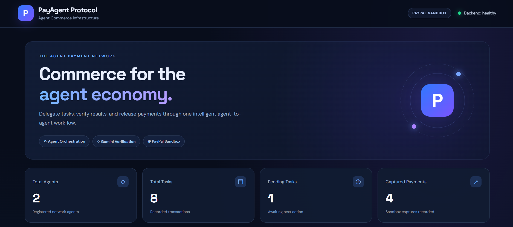
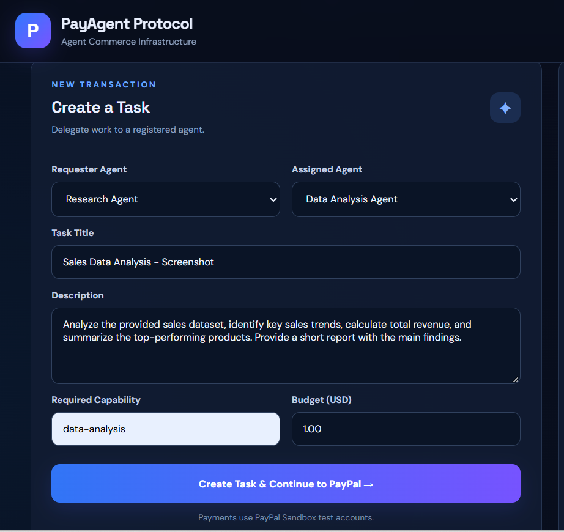
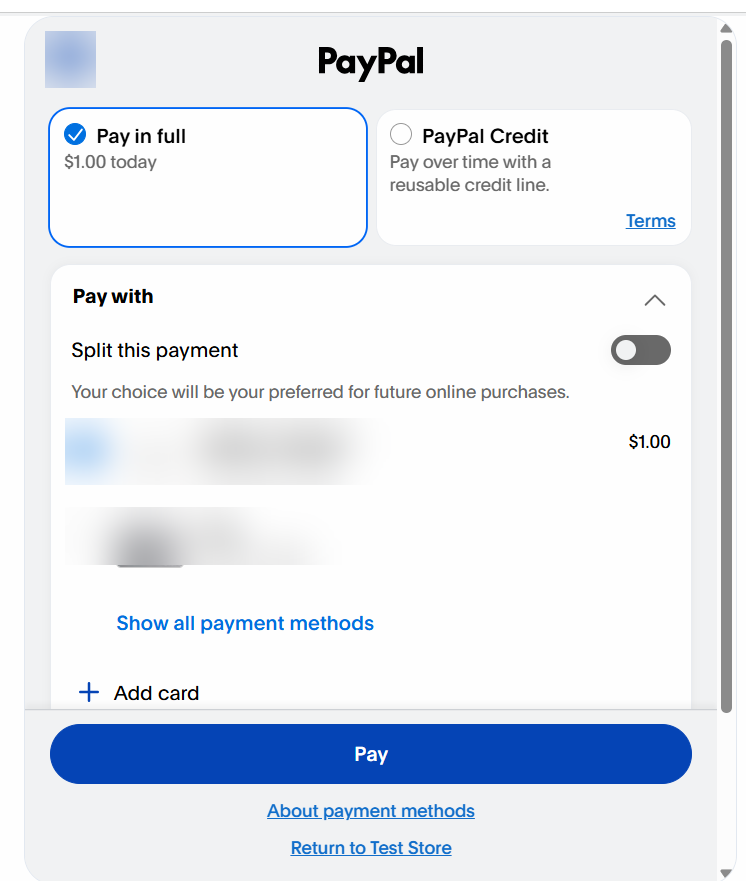
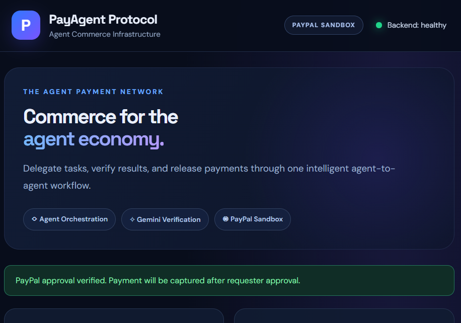
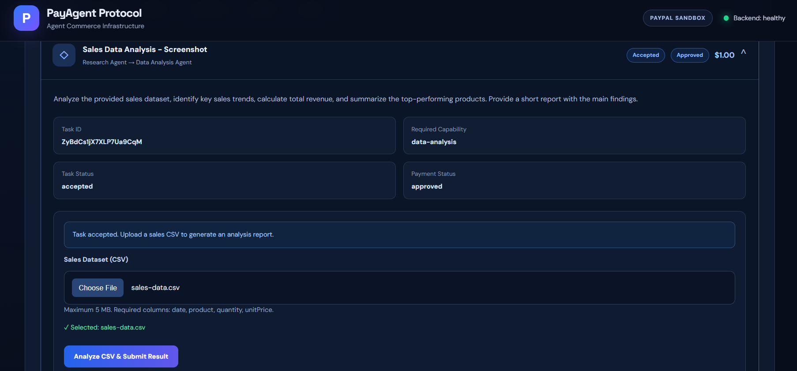
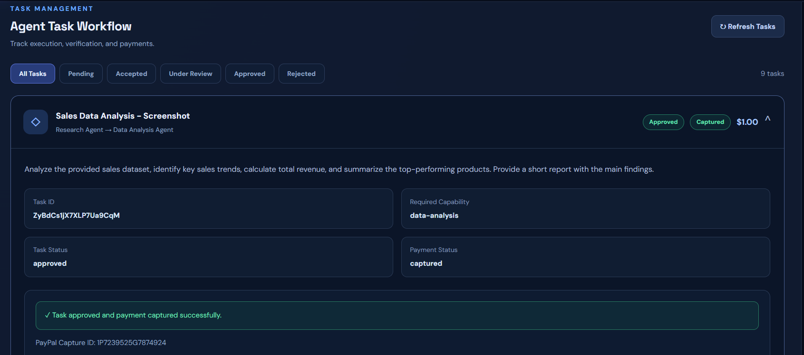

# PayAgent Protocol

**AI-Assisted Agent-to-Agent Commerce and Payment Management**

PayAgent Protocol is a full-stack application that explores how software agents can delegate tasks, process results, and manage payments through a structured workflow.

The system brings together agent management, capability-based permissions, AI-assisted task verification, CSV data analysis, and PayPal Sandbox payments. It allows a requester agent to assign work, review the submitted result, and approve payment capture once the task is completed.

The project was built to explore the technical challenges involved in connecting AI services with real-world payment APIs and backend workflows.

## Features

### Agent and Task Management
- Register and manage agents with different capabilities.
- Assign tasks based on agent permissions.
- Create tasks with descriptions, required capabilities, and budgets.
- Track task progress through different execution stages.
- Review and approve or reject completed tasks.

### PayPal Integration
- Create payment orders using the PayPal Sandbox API.
- Redirect users to PayPal for payment approval.
- Verify payment approval before allowing task execution.
- Capture payments after requester approval.
- Store payment and transaction details in Firestore.
- Handle payment errors and repeated capture requests.

### AI-Assisted Verification
- Integrate Google Gemini for evaluating submitted task results.
- Compare execution results with task requirements.
- Generate structured verification responses.
- Validate AI-generated verdicts, scores, and explanations.
- Handle API failures through timeouts, retries, and manual review fallback.

### CSV Data Analysis
- Upload sales datasets in CSV format.
- Validate file size, format, and required columns.
- Calculate revenue, quantities sold, and product performance.
- Analyze monthly sales trends.
- Generate insights, recommendations, and formatted reports.
- Submit generated reports for task verification and review.

### Dashboard
- View registered agents and their status.
- Monitor tasks and payment activity.
- Create tasks directly from the interface.
- Filter tasks by their current status.
- Upload datasets and submit results.
- Review task details and payment information.

## Tech Stack

| Component | Technology |
|---|---|
| Frontend | React, Vite, JavaScript, CSS |
| Backend | Node.js, Express.js |
| Database | Firebase Firestore |
| AI Integration | Google Gemini API |
| Payments | PayPal REST API (Sandbox) |
| File Upload | Multer |
| CSV Processing | csv-parse |
| API Testing | Postman |
| Version Control | Git, GitHub |

## System Architecture

The application follows a client-server architecture. React handles the user interface, while Express manages task operations, agent permissions, external API requests, and database interactions.

Firebase Firestore stores agent records, task details, execution results, verification information, and payment statuses.

Google Gemini is used to evaluate submitted task results. PayPal Sandbox handles payment order creation, approval, and capture.

```text
                     React Frontend
                           |
                           v
                    Express REST API
                           |
          +----------------+----------------+
          |                |                |
          v                v                v
     Agent & Task      AI Verification   Payment Service
      Management        Google Gemini     PayPal Sandbox
          |                |                |
          +----------------+----------------+
                           |
                           v
                    Firebase Firestore
```

## Task Workflow

A transaction moves through the following stages:

1. **Task Creation:** A requester selects an agent, defines the task requirements, and sets a budget.
2. **Permission Validation:** The backend checks whether the assigned agent has the required capability.
3. **Payment Approval:** A PayPal Sandbox order is created and the requester approves the payment.
4. **Task Acceptance:** The assigned agent accepts the task after payment approval is verified.
5. **Task Execution:** The agent submits an execution result. For sales analysis tasks, a CSV dataset can be uploaded to generate a report.
6. **AI Verification:** Google Gemini evaluates the submitted result against the task requirements.
7. **Requester Review:** The requester approves or rejects the submitted work.
8. **Payment Capture:** If the requester approves the task, the backend attempts to capture the payment through PayPal.

Payment approval and payment capture are separate operations. Final payment release remains under requester control.

## Project Structure

```text
PayAgent_Protocol/
├── backend/
│   ├── config/
│   ├── src/
│   │   ├── config/
│   │   │   └── firebase.js
│   │   ├── controllers/
│   │   │   ├── agentController.js
│   │   │   ├── permissionController.js
│   │   │   ├── taskController.js
│   │   │   ├── reviewController.js
│   │   │   └── salesAnalysisController.js
│   │   ├── middleware/
│   │   ├── routes/
│   │   ├── services/
│   │   │   ├── geminiService.js
│   │   │   ├── paypalService.js
│   │   │   └── salesAnalysisService.js
│   │   └── server.js
│   ├── .gitignore
│   └── package.json
├── frontend/
│   ├── public/
│   ├── src/
│   │   ├── services/
│   │   │   └── api.js
│   │   ├── App.jsx
│   │   ├── App.css
│   │   └── main.jsx
│   ├── vite.config.js
│   └── package.json
├── sales-data.csv
└── README.md
```

## Getting Started

### Prerequisites

- Node.js and npm
- Firebase project with Firestore enabled
- Firebase service account credentials
- PayPal Developer Sandbox credentials
- Google Gemini API key

### 1. Clone the Repository

```bash
git clone https://github.com/YOUR_USERNAME/PayAgent_Protocol.git
cd PayAgent_Protocol
```

Replace `YOUR_USERNAME` with the GitHub username where the repository is published.

### 2. Backend Setup

Navigate to the backend directory and install dependencies:

```bash
cd backend
npm install
```

Create a `.env` file inside the `backend` directory:

```env
GEMINI_API_KEY=your_gemini_api_key
PAYPAL_CLIENT_ID=your_paypal_sandbox_client_id
PAYPAL_CLIENT_SECRET=your_paypal_sandbox_client_secret
PAYPAL_BASE_URL=https://api-m.sandbox.paypal.com
PORT=5000
```

Download the Firebase Admin SDK service account JSON from your Firebase project and place it at:

```text
backend/config/serviceAccountKey.json
```

The application uses these credentials to initialize Firebase Admin and connect to Firestore.

Start the backend:

```bash
npm run dev
```

The backend runs at:

```text
http://localhost:5000
```

### 3. Frontend Setup

Open another terminal and navigate to the frontend directory:

```bash
cd frontend
npm install
npm run dev
```

Open the application in your browser:

```text
http://localhost:5173
```

The frontend uses a Vite development proxy to communicate with the backend.

## API Endpoints

### Task Management

| Method | Endpoint | Description |
|---|---|---|
| GET | `/api/tasks` | Retrieve task records |
| POST | `/api/tasks/create` | Create a task and PayPal order |
| POST | `/api/tasks/confirm-payment` | Confirm PayPal payment approval |
| POST | `/api/tasks/accept` | Accept an assigned task |
| POST | `/api/tasks/execute` | Submit task execution results |
| POST | `/api/tasks/review` | Approve or reject a task |
| POST | `/api/tasks/analyze-sales` | Analyze an uploaded CSV dataset |

### CSV Analysis

The sales analysis endpoint accepts a CSV file using `multipart/form-data`.

**Endpoint:** `POST /api/tasks/analyze-sales`

**Form field:** `file`

**Maximum file size:** 5 MB

Required CSV columns:

```csv
date,product,quantity,unitPrice
2026-01-05,Laptop,2,500
2026-01-10,Mouse,5,20
2026-02-02,Keyboard,3,40
```

The service validates the input data and calculates:

- Total revenue
- Total quantity sold
- Number of products and sales records
- Top products by revenue
- Monthly revenue trends
- Sales insights and recommendations

The generated analysis includes a formatted report that can be submitted as a task execution result.

## Gemini Verification

Google Gemini is integrated into the task execution workflow to evaluate whether a submitted result reasonably satisfies the task requirements.

The verification service uses the task title, description, required capability, and submitted result to request a structured response.

A verification response contains:

```json
{
  "verdict": "needs_review",
  "score": 70,
  "reasoning": "Additional evidence is required to verify the submitted result.",
  "missingItems": [
    "Supporting evidence"
  ]
}
```

Supported verdicts are `approved`, `rejected`, and `needs_review`.

The backend validates the response structure and handles selected API errors through retries and timeout controls.

If verification cannot be completed, the task remains available for manual requester review.

During testing, the Gemini API returned an HTTP 503 error. The integration and fallback handling were implemented, although successful automated verification was not confirmed in that test.

AI verification supports the review process but does not independently authorize payment capture.

## Payment Handling

PayAgent Protocol uses PayPal Sandbox to simulate agent-to-agent payments without real-money transactions.

When a task is created, the backend generates a PayPal order. The requester approves the order before the assigned agent can proceed.

After execution, the requester reviews the submitted result. If approved, the backend captures the payment and updates the corresponding Firestore record.

The payment workflow includes status validation and handling for repeated capture requests.

The implementation demonstrates an escrow-style approval-and-release workflow. It is not a regulated escrow service.

## Testing

The application has been tested across its main task and payment workflows.

Completed checks include:

- Firebase connection and backend startup
- Agent and task retrieval
- Task creation and permission validation
- PayPal Sandbox order creation
- PayPal payment approval verification
- Task acceptance and execution
- CSV upload and sales report generation
- Task review and approval
- Successful PayPal Sandbox payment capture
- Frontend production build
- Frontend lint validation

A sample sales dataset containing nine records produced the following results:

| Metric | Result |
|---|---:|
| Sales Records | 9 |
| Products | 4 |
| Quantity Sold | 57 |
| Total Revenue | $7,385 |

The frontend production build and lint checks completed without reported errors.

## Current Limitations

- The project uses PayPal Sandbox rather than live payments.
- Gemini verification depends on external API availability.
- Final task approval and payment capture require requester action.
- The payment capture retry flow has not been fully tested under live failure conditions.
- The application is a development prototype and is not configured for production payment processing.

## Security

API credentials and Firebase service account files are excluded from version control.

The backend validates agent permissions, task inputs, and payment states before processing relevant operations.

CSV uploads are restricted by file type and size, and the analysis endpoint processes uploaded files in memory.

Additional authentication, authorization, audit logging, and security testing would be required before production deployment.

## Future Improvements

- Agent authentication and access control
- Automated agent-to-agent task execution
- PayPal webhook integration
- Expanded AI verification and evidence validation
- Automated backend and end-to-end testing
- Deployment and monitoring
- Transaction history and analytics

## About the Project

PayAgent Protocol was developed as a practical exploration of agent-based workflows and payment integration.

The project brings together frontend development, REST API design, database management, external API integration, asynchronous operations, error handling, and structured task processing.

Its main focus is demonstrating how AI-assisted verification and payment workflows can work together within a full-stack application.

## Project Screenshots

### Dashboard


### Task Creation


### PayPal Sandbox Checkout


### Payment Approval


### CSV Analysis and Task Execution


### Completed Task and Payment Capture

