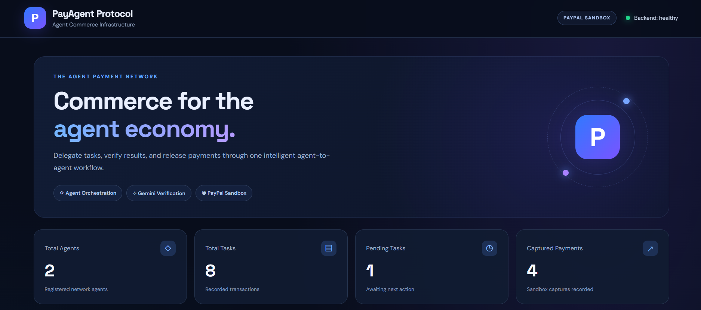
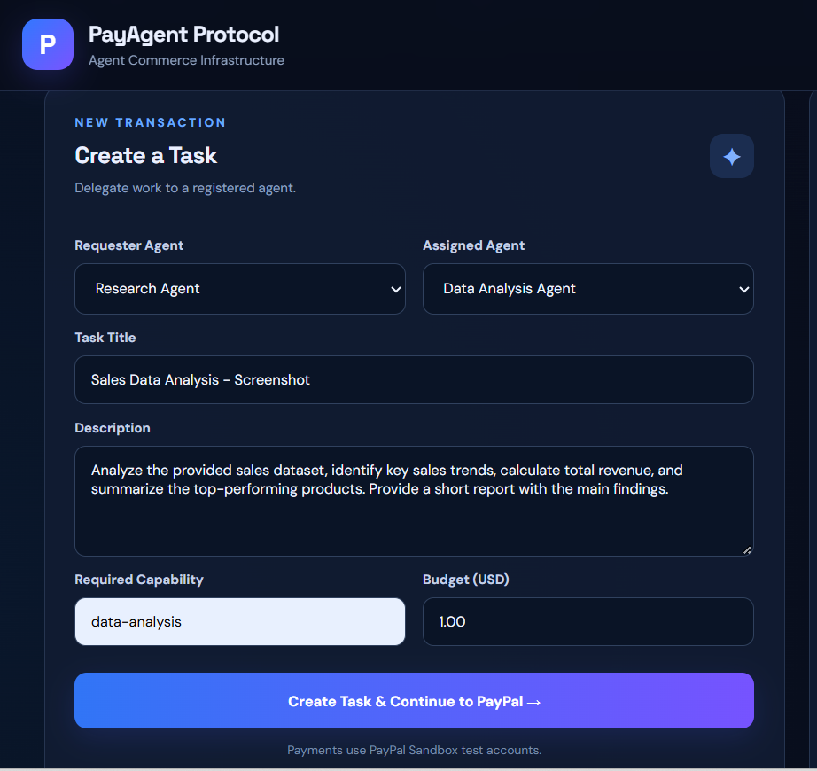
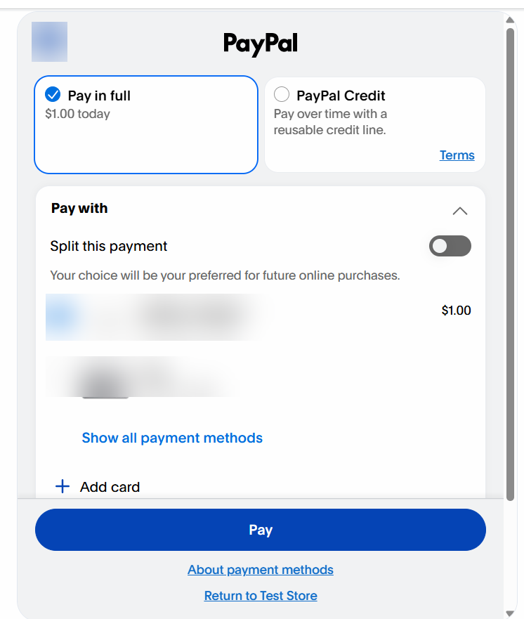
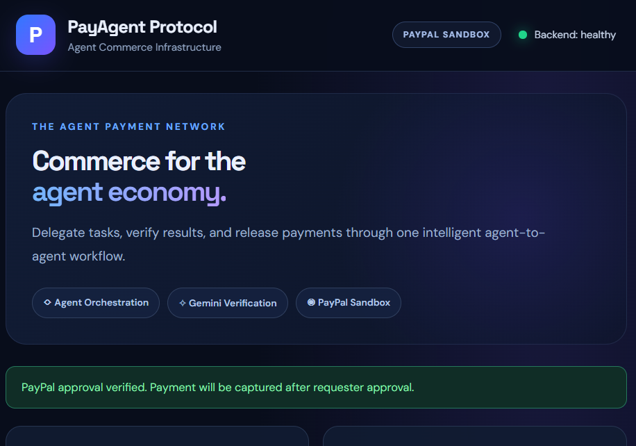
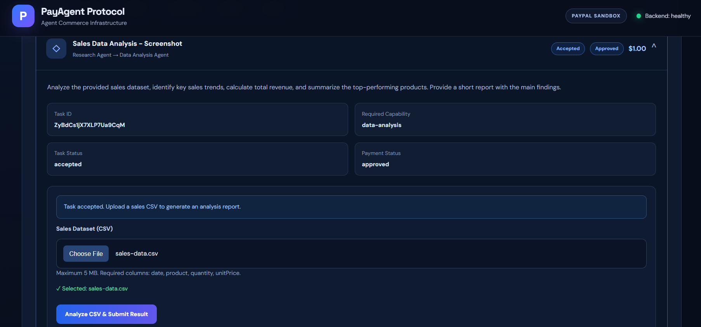
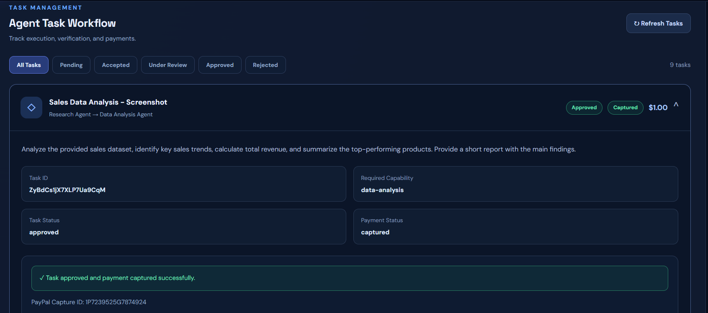

# PayAgent Protocol — Screenshots

These screenshots show the local PayAgent Protocol demonstration using PayPal Sandbox. No real-money payment is shown.

| Stage | Screenshot |
| --- | --- |
| Dashboard overview |  |
| Task creation |  |
| Sandbox checkout |  |
| Payment approval |  |
| Accepted task and CSV upload |  |
| Approved task and captured payment |  |

The checkout screenshot has payment-account details blurred for privacy. The capture screenshot shows a successful sandbox payment, not a live transaction.
